# Architecture

Diagrams of how the Terraform provider for Lakekeeper is built, ordered from concepts to code. Read them in this order:

1. [System context](#system-context): what the provider talks to
2. [Domain model](#domain-model): what the provider manages
3. [Apply sequence](#apply-sequence): how one `terraform apply` reaches Lakekeeper
4. [Package layers](#package-layers): where code goes
5. [Assignment module](#assignment-module): how assignment resources are built
6. [Warehouse module](#warehouse-module): how a warehouse is converted to and from the API
7. [Development workflow](#development-workflow): from edit to release

The [Terms](#terms) section defines the words the diagrams use. The [drift table](#drift-table) lists the source each diagram shows.

## Reading and updating the diagrams

Each diagram has three files here, named after its slug:

- `<slug>-light.svg` and `<slug>-dark.svg`: the images shown below, matching your GitHub theme
- `<slug>.html`: an explorable version with zoom, focus, search and themes. GitHub shows its source, so clone the repository or download the file and open it locally in a browser.
- `<slug>.json`: the diagram's source. Review diagram changes in this file.

Reading and reviewing the diagrams needs nothing beyond a browser.

When a change touches source listed in the [drift table](#drift-table), update that diagram in two steps:

1. **Edit `<slug>.json`.** This part needs judgement, from a person or a coding agent with the [Archify](https://github.com/tt-a1i/archify) skill: decide what the diagram shows, label it with the words from [Terms](#terms), and cite the source file and lines behind each element. It needs only an editor.
2. **Render it:** `make diagrams-render DIAGRAMS=<slug>`, then set the diagram's date in the drift table to today. This part is mechanical. It needs Archify, Chrome and Node; set `ARCHIFY` to Archify's `bin/archify.mjs` if `archify` is not on your `PATH`. The command checks every citation against the current commit (`HEAD`), so commit your code changes first. It writes `HEAD` into `meta.repository.revision`; don't edit that by hand.

Without `DIAGRAMS`, it renders every diagram. Renders go to `.archify/` (gitignored) and are then copied here.

If you rendered with the Archify skill instead, into `.archify/<type>-<slug>-<YYYYMMDD-HHMMSS>/`, run `make diagrams` to copy the newest render of each diagram here; it does not run Archify.

## System context

<picture>
  <source media="(prefers-color-scheme: dark)" srcset="system-context-dark.svg">
  <source media="(prefers-color-scheme: light)" srcset="system-context-light.svg">
  
</picture>

Terraform runs the provider as a plugin. The provider's resources and data sources call the API client layer (`internal/provider/api`), the only package that imports the Lakekeeper Go SDK; a `depguard` rule in `.golangci.yml` enforces this. The SDK sends HTTPS requests to the Lakekeeper server's REST API. It authenticates each request with a token that it fetches from the OIDC identity provider using the client credentials grant.

The provider configuration (`endpoint`, `auth_url`, `client_id`, `client_secret`, `scopes`, `cacert_file`, `insecure`) is read once in `Configure`, which builds one `*api.Client` for every resource and data source.

Explorable version: [`system-context.html`](system-context.html) (open locally).

## Domain model

<picture>
  <source media="(prefers-color-scheme: dark)" srcset="domain-model-dark.svg">
  <source media="(prefers-color-scheme: light)" srcset="domain-model-light.svg">
  
</picture>

The server contains users and projects. A user belongs to the server, never to a project; it only holds grants there. A project contains roles and warehouses, and a warehouse contains namespaces. The default project is an ordinary project; the provider reads it by passing the nil UUID as the project ID (`lakekeeper_default_project`).

An assignment is one assignee holding a set of grant types at one scope. A user or a role can be an assignee. The five kinds of scope are server, project, warehouse, role and namespace, and each has its own grant types. A role appears on both sides: as an assignee it receives grants, and as a scope it has users and other roles assigned to it. Every scope has a `lakekeeper_<scope>_role_assignment` resource, and every scope except namespace also has a `lakekeeper_<scope>_user_assignment` resource.

Explorable version: [`domain-model.html`](domain-model.html) (open locally).

## Apply sequence

<picture>
  <source media="(prefers-color-scheme: dark)" srcset="apply-sequence-dark.svg">
  <source media="(prefers-color-scheme: light)" srcset="apply-sequence-light.svg">
  
</picture>

Terraform first sends the provider configuration to `Configure` (`internal/provider/provider.go`). It builds one `*api.Client` through `Config.NewLakekeeperClient` (`internal/provider/api/config.go`), which sets up TLS (`cacert_file`, `insecure`) and the OAuth 2.0 client credentials token source for `auth_url`, before any resource runs. The SDK fetches the access token on its first request: with `initial_bootstrap` on (the default) that is the server info check in `Configure`. The token request has its own 2-second timeout and does not use the TLS settings, so look here when authentication fails.

A resource's `Create` and `Read` (here `lakekeeper_role`) call one API client method each. The SDK sends the HTTPS request with the bearer token and retries 429 and 5xx responses. The API client layer wraps errors in `*api.Error` with the HTTP status, and the resource writes the result to Terraform state or reports an error diagnostic.

Explorable version: [`apply-sequence.html`](apply-sequence.html) (open locally).

## Package layers

<picture>
  <source media="(prefers-color-scheme: dark)" srcset="package-layers-dark.svg">
  <source media="(prefers-color-scheme: light)" srcset="package-layers-light.svg">
  
</picture>

All resources and data sources live in `package provider` (`internal/provider`), one `resource_*.go` or `datasource_*.go` file per Terraform type. Each file registers itself in an `init()` function, and the provider hands the registered lists to Terraform, so adding the file is all the wiring a new resource or data source needs. The warehouse module (`internal/provider/warehouse`) holds the warehouse schemas, models and conversions. The assignment schema fragment (`internal/provider/sdk`) is shared by the project and warehouse assignments data sources; despite its package name it is not the Lakekeeper Go SDK.

Every package calls Lakekeeper through `*api.Client` and the types in the API client layer (`internal/provider/api`). Only that package imports the Lakekeeper Go SDK; the `depguard` rule `lakekeeper-sdk` in `.golangci.yml` fails `make lint` for any other import. When an endpoint is missing, add a method to `*api.Client`.

Explorable version: [`package-layers.html`](package-layers.html) (open locally).

## Assignment module

<picture>
  <source media="(prefers-color-scheme: dark)" srcset="assignment-module-dark.svg">
  <source media="(prefers-color-scheme: light)" srcset="assignment-module-light.svg">
  
</picture>

Each of the nine assignment resources is one file that declares an assignment descriptor and registers `newAssignmentResource(descriptor)`. The shared assignment resource (`assignment_resource.go`) derives the schema, internal ID, import and lifecycle from it. A new grant type goes into a descriptor's grant types; a new kind of scope needs a new scope adapter (`assignment_adapter_<scope>.go`) plus the `*api.Client` methods it calls. Scope adapters are the only assignment code that calls the API client layer.

Every create, update and delete reconciles against the server. It reads all direct grants at the scope, keeps only the assignee's own, compares their grant types with the configuration, and sends the revokes and grants as one atomic request, or nothing when they match. Grants that other assignees hold at the scope are never touched, and a failed read never leads to a write. Create also fails if the assignee already holds a direct grant at the scope; import it first.

Explorable version: [`assignment-module.html`](assignment-module.html) (open locally).

## Warehouse module

<picture>
  <source media="(prefers-color-scheme: dark)" srcset="warehouse-module-dark.svg">
  <source media="(prefers-color-scheme: light)" srcset="warehouse-module-light.svg">
  
</picture>

The warehouse module (`internal/provider/warehouse`) owns the warehouse's schemas, models and conversions; `resource_warehouse.go` and `datasource_warehouse.go` only orchestrate. On the way out, `WarehouseRequest` turns the plan's resource model into a warehouse request: exactly one storage profile (S3 or S3-compatible, ADLS or GCS), its storage credential, and the delete profile (`hard`, or `soft` with an expiration; an absent one is sent as `hard`). On the way back, `Refresh` builds the new state from the server's warehouse plus the prior state. The data source reads the same server fields through `DataSourceModelFromAPI` and shares the module's schemas.

Lakekeeper never returns the storage credential. `Refresh` copies it from the prior state, and only when the storage profile kept its type; after an import, or when the type changed on the server, it stays null. The data source never holds one.

Explorable version: [`warehouse-module.html`](warehouse-module.html) (open locally).

## Development workflow

<picture>
  <source media="(prefers-color-scheme: dark)" srcset="development-workflow-dark.svg">
  <source media="(prefers-color-scheme: light)" srcset="development-workflow-light.svg">
  
</picture>

A change goes from an edit through `make reviewable` (build, format, generate docs, unit tests) and `make testacc`, which runs the acceptance tests against the local stack started by `make testacc-up`. It is committed as a conventional commit and opened as a pull request, where CI checks the title and reruns lint, the generated-docs check and the tests. Once squash-merged to `main`, release-please opens a release pull request and, when that is merged, tags the version that GoReleaser publishes.

The top row holds generated files. `docs/` is the Terraform Registry documentation that `make generate` builds with `tfplugindocs` from `templates/`, `examples/` and the schema descriptions in the Go code: edit those sources, never `docs/`. `CHANGELOG.md` and `.release-please-manifest.json` belong to release-please. [`CONTRIBUTING.md`](../CONTRIBUTING.md) is the source of truth for the commands and details.

Explorable version: [`development-workflow.html`](development-workflow.html) (open locally).

## Terms

The diagrams use these terms exactly. Each subsection lists the terms a diagram introduces; a term is defined only where it first appears.

### System context terms

- **Server**: one Lakekeeper installation, reached through its REST API at the provider's `endpoint`.
- **Provider**: this Terraform provider. Terraform runs it as a plugin process.
- **Provider configuration**: the `provider "lakekeeper"` block (`endpoint`, `auth_url`, `client_id`, `client_secret`, `scopes`, `cacert_file`, `insecure`, `initial_bootstrap`), or the `LAKEKEEPER_*` environment variables for unset values. `Configure` reads it once per run.
- **API client layer**: the `internal/provider/api` package. It wraps the Lakekeeper Go SDK and gives resources and data sources SDK-neutral types.
- **Lakekeeper Go SDK**: the Go client library for the Lakekeeper REST API ([`go-lakekeeper`](https://github.com/baptistegh/go-lakekeeper)).
- **OIDC identity provider**: the OpenID Connect server that issues the provider's access tokens, for example Keycloak. The provider authenticates with the OAuth 2.0 client credentials grant at `auth_url`.

### Domain model terms

- **Project**: a container on the server for warehouses and roles (`lakekeeper_project`).
- **Default project**: the server's default project, an ordinary project that the provider reads by passing the nil UUID as the project ID (`lakekeeper_default_project`).
- **Warehouse**: an Iceberg storage location in a project, with its own storage configuration (`lakekeeper_warehouse`).
- **Namespace**: a container for tables and views inside a warehouse (`lakekeeper_namespace`).
- **User**: a human or application identity known to the server (`lakekeeper_user`). A user belongs to the server, never to a project.
- **Role**: a named identity that belongs to one project (`lakekeeper_role`). A role is both an assignee, which holds grants, and a scope, which users and other roles are assigned to.
- **Scope**: the server or the project, warehouse, role or namespace that a grant is attached to.
- **Assignee**: the user or role that holds a grant.
- **Grant type**: one permission level allowed at a kind of scope, for example `select` on a warehouse or `admin` on the server.
- **Grant**: one grant type held by one assignee at one scope.
- **Assignment**: the set of grants one assignee holds at one scope. Each `lakekeeper_*_assignment` resource manages one assignment.

### Apply sequence terms

- **Resource**: a Terraform resource type such as `lakekeeper_role`. Its `Create`, `Read`, `Update` and `Delete` each call the API client layer.
- **Terraform state**: Terraform's record of each resource's attributes. A resource writes the server's values into it after every create, read and update.
- **Access token**: the bearer token the SDK sends with each request to the server. The identity provider issues it for the client credentials grant; the SDK reuses it until it expires.
- **Bootstrap**: the one-time initialisation of a new server. With `initial_bootstrap` on, the SDK checks the server info while the provider is configured and bootstraps the server if needed.

### Package layers terms

- **Provider package**: `package provider` in `internal/provider`. It holds the provider itself, registration, and every resource and data source.
- **Registration**: each resource or data source file calls `registerResource` or `registerDataSource` from its `init()` function; the provider returns the collected lists to Terraform.
- **Warehouse module**: the `internal/provider/warehouse` package. It owns the warehouse resource and data source schemas, their models, and their conversions to and from the API client layer's types.
- **Assignment schema fragment**: the `internal/provider/sdk` package. It holds the nested `assignments` schema and model shared by the project and warehouse assignments data sources. It does not import the Lakekeeper Go SDK.
- **depguard rule**: the `lakekeeper-sdk` rule in `.golangci.yml`. It denies importing the Lakekeeper Go SDK in every file outside `internal/provider/api`.

### Assignment module terms

- **Direct grant**: a grant an assignee holds directly at a scope, as opposed to one it inherits through a role or from a parent scope. Assignment resources read and write only direct grants.
- **Assignment descriptor**: the `assignmentDescriptor` value that declares one assignment resource: its identity attributes, allowed grant types and scope adapter.
- **Assignment resource factory**: `newAssignmentResource`, which turns an assignment descriptor into a complete Terraform resource.
- **Scope adapter**: the `scopeAdapter` for one kind of scope. It lists the direct grants at a scope and applies revokes and grants in one request through the API client layer.

### Warehouse module terms

- **Storage profile**: where a warehouse stores its data: exactly one of S3 (or an S3-compatible store), ADLS or GCS, with its location settings.
- **Storage credential**: the secret Lakekeeper uses to access the storage profile. The provider sends it but never reads it back, so it comes only from configuration or prior state.
- **Delete profile**: what happens when a table or view in the warehouse is dropped: `hard` deletes it at once, `soft` keeps it for an expiration period first.
- **Resource model**: `ResourceModel`, the `lakekeeper_warehouse` resource's plan or state as Go values.
- **Data source model**: `DataSourceModel`, the `lakekeeper_warehouse` data source's state. It has no storage credential.
- **Warehouse request**: `api.CreateWarehouseRequest`, the name, storage profile, storage credential and delete profile that create a warehouse.
- **Prior state**: the values `Refresh` starts from: the plan in Create and Update, the state in Read. The storage credential comes from it.
- **Refresh**: `warehouse.Refresh`, which builds the new resource state from the prior state and the server's warehouse.

### Development workflow terms

- **Acceptance test**: a Go test with the `//go:build acceptance` tag that creates real resources on a running server. `make testacc` runs them.
- **Local stack**: the Docker Compose setup in `run/` (Lakekeeper, Keycloak as the OIDC identity provider, PostgreSQL and OpenFGA) that `make testacc-up` starts for acceptance tests.
- **Generated file**: a file a tool writes and nobody edits by hand: `docs/` (from `tfplugindocs`) and `CHANGELOG.md` with `.release-please-manifest.json` (from release-please).
- **Conventional commit**: a commit message or pull request title of the form `type: description`, such as `fix: handle empty role list`; `!` after the type marks a breaking change.
- **release-please**: the GitHub workflow that reads the conventional commits on `main`, opens a release pull request with the next version and changelog, and tags the release.

## Drift table

Each diagram, the source it shows, and the date it was last checked against the code.

| Diagram | Source it shows | Last checked |
| --- | --- | --- |
| [System context](#system-context) | `main.go`, `internal/provider/provider.go`, `internal/provider/registry.go`, `internal/provider/api/client.go`, `internal/provider/api/config.go`, `go.mod`, `.golangci.yml` | 2026-11-06 |
| [Domain model](#domain-model) | `internal/provider/api/management.go`, `internal/provider/api/permissions.go`, `internal/provider/api/constants.go`, `internal/provider/assignment_adapter.go`, `internal/provider/assignment_descriptor.go`, `internal/provider/resource_user.go`, `internal/provider/resource_role.go`, `internal/provider/resource_project.go`, `internal/provider/resource_namespace.go`, `internal/provider/resource_namespace_role_assignment.go`, `internal/provider/datasource_default_project.go`, `internal/provider/warehouse/warehouse.go` | 2026-11-06 |
| [Apply sequence](#apply-sequence) | `main.go`, `internal/provider/provider.go`, `internal/provider/resource_role.go`, `internal/provider/api/config.go`, `internal/provider/api/management.go`, `internal/provider/api/client.go`, `go.mod` | 2026-11-06 |
| [Package layers](#package-layers) | `main.go`, `internal/provider/provider.go`, `internal/provider/registry.go`, `internal/provider/resource_role.go`, `internal/provider/datasource_project.go`, `internal/provider/resource_warehouse.go`, `internal/provider/warehouse/warehouse.go`, `internal/provider/sdk/assignment.go`, `internal/provider/datasource_project_assignments.go`, `internal/provider/datasource_warehouse_assignments.go`, `internal/provider/api/client.go`, `internal/provider/api/management.go`, `internal/provider/api/config.go`, `go.mod`, `.golangci.yml` | 2026-11-06 |
| [Assignment module](#assignment-module) | `internal/provider/assignment_descriptor.go`, `internal/provider/assignment_resource.go`, `internal/provider/assignment_adapter.go`, `internal/provider/assignment_adapter_*.go`, `internal/provider/resource_*_assignment.go`, `internal/provider/registry.go`, `internal/provider/api/permissions.go`, `internal/provider/api/namespaces.go` | 2026-11-06 |
| [Warehouse module](#warehouse-module) | `internal/provider/warehouse/warehouse.go`, `internal/provider/warehouse/storage_profile.go`, `internal/provider/warehouse/storage_credential.go`, `internal/provider/warehouse/delete_profile.go`, `internal/provider/warehouse/schema.go`, `internal/provider/warehouse/storage_profile_schema.go`, `internal/provider/resource_warehouse.go`, `internal/provider/datasource_warehouse.go`, `internal/provider/api/warehouses.go` | 2026-11-06 |
| [Development workflow](#development-workflow) | `Makefile`, `CONTRIBUTING.md`, `tools/tools.go`, `run/docker-compose.yml`, `.github/workflows/pr.yml`, `.github/workflows/test.yml`, `.github/workflows/release-please.yml`, `.github/workflows/release.yml`, `release-please-config.json` | 2026-11-06 |
