# Architecture

Diagrams of how the Terraform provider for Lakekeeper is built, ordered from concepts to code. Read them in this order:

1. [System context](#system-context): what the provider talks to
2. [Domain model](#domain-model): what the provider manages
3. [Apply sequence](#apply-sequence): how one `terraform apply` reaches Lakekeeper
4. [Package layers](#package-layers): where code goes
5. [Assignment module](#assignment-module): how assignment resources are built
6. [Warehouse module](#warehouse-module): how a warehouse is converted to and from the API
7. [Development workflow](#development-workflow): from edit to release

The [Terms](#terms) section defines the words the diagrams use. The [drift table](#drift-table) lists the source each diagram shows.

## Reading and updating the diagrams

Each diagram has three files here, named after its slug:

- `<slug>-light.svg` and `<slug>-dark.svg`: the images shown below, matching your GitHub theme
- `<slug>.html`: an explorable version with zoom, focus, search and themes. GitHub shows its source, so clone the repository or download the file and open it locally in a browser.
- `<slug>.json`: the diagram's source. Review diagram changes in this file.

Reading and reviewing the diagrams needs nothing beyond a browser. Re-rendering one needs [Archify](https://github.com/tt-a1i/archify) and Chrome. When a change touches source listed in the [drift table](#drift-table), update that diagram:

1. Copy `<slug>.json` to `.archify/<type>-<slug>-<YYYYMMDD-HHMMSS>/candidate.json`, where `<type>` is its `diagram_type` and the timestamp is the current local time. `.archify/` is gitignored.
2. Edit the candidate. Set `meta.output` to `<that folder>/<slug>.html` and `meta.repository.revision` to the commit you checked the code at.
3. Render it: `archify finalize <type> <folder>/candidate.json <folder>/<slug>.html --repo-root . --quality showcase`. The `--repo-root` check fails when a cited source file or line range no longer exists at that commit.
4. Export the images: `node scripts/export-diagram-svg.mjs <folder>`.
5. Run `make diagrams`. It copies the newest render of each diagram into this folder under stable names; it does not run Archify.
6. Set the diagram's commit in the drift table to the short form of `meta.repository.revision`.

## System context

<picture>
  <source media="(prefers-color-scheme: dark)" srcset="system-context-dark.svg">
  <source media="(prefers-color-scheme: light)" srcset="system-context-light.svg">
  
</picture>

Terraform runs the provider as a plugin. The provider's resources and data sources call the API client layer (`internal/provider/api`), the only package that imports the Lakekeeper Go SDK; a `depguard` rule in `.golangci.yml` enforces this. The SDK sends HTTPS requests to the Lakekeeper server's REST API. It authenticates each request with a token that it fetches from the OIDC identity provider using the client credentials grant.

The provider configuration (`endpoint`, `auth_url`, `client_id`, `client_secret`, `scopes`, `cacert_file`, `insecure`) is read once in `Configure`, which builds one `*api.Client` for every resource and data source.

Explorable version: [`system-context.html`](system-context.html) (open locally).

## Domain model

_Not drawn yet._

## Apply sequence

_Not drawn yet._

## Package layers

<picture>
  <source media="(prefers-color-scheme: dark)" srcset="package-layers-dark.svg">
  <source media="(prefers-color-scheme: light)" srcset="package-layers-light.svg">
  
</picture>

All resources and data sources live in `package provider` (`internal/provider`), one `resource_*.go` or `datasource_*.go` file per Terraform type. Each file registers itself in an `init()` function, and the provider hands the registered lists to Terraform, so adding the file is all the wiring a new resource or data source needs. The warehouse module (`internal/provider/warehouse`) holds the warehouse schemas, models and conversions. The assignment schema fragment (`internal/provider/sdk`) is shared by the project and warehouse assignments data sources; despite its package name it is not the Lakekeeper Go SDK.

Every package calls Lakekeeper through `*api.Client` and the types in the API client layer (`internal/provider/api`). Only that package imports the Lakekeeper Go SDK; the `depguard` rule `lakekeeper-sdk` in `.golangci.yml` fails `make lint` for any other import. When an endpoint is missing, add a method to `*api.Client`.

Explorable version: [`package-layers.html`](package-layers.html) (open locally).

## Assignment module

_Not drawn yet._

## Warehouse module

_Not drawn yet._

## Development workflow

_Not drawn yet._

## Terms

The diagrams use these terms exactly. Each group lists the terms a diagram introduces; a term is defined only where it first appears.

### System context terms

- **Server**: one Lakekeeper installation, reached through its REST API at the provider's `endpoint`.
- **Provider**: this Terraform provider. Terraform runs it as a plugin process.
- **API client layer**: the `internal/provider/api` package. It wraps the Lakekeeper Go SDK and gives resources and data sources SDK-neutral types.
- **Lakekeeper Go SDK**: the Go client library for the Lakekeeper REST API ([`go-lakekeeper`](https://github.com/baptistegh/go-lakekeeper)).
- **OIDC identity provider**: the OpenID Connect server that issues the provider's access tokens, for example Keycloak. The provider authenticates with the OAuth 2.0 client credentials grant at `auth_url`.

### Domain model terms

_Not written yet._

### Apply sequence terms

_Not written yet._

### Package layers terms

- **Provider package**: `package provider` in `internal/provider`. It holds the provider itself, registration, and every resource and data source.
- **Registration**: each resource or data source file calls `registerResource` or `registerDataSource` from its `init()` function; the provider returns the collected lists to Terraform.
- **Warehouse module**: the `internal/provider/warehouse` package. It owns the warehouse resource and data source schemas, their models, and their conversions to and from the API client layer's types.
- **Assignment schema fragment**: the `internal/provider/sdk` package. It holds the nested `assignments` schema and model shared by the project and warehouse assignments data sources. It does not import the Lakekeeper Go SDK.
- **depguard rule**: the `lakekeeper-sdk` rule in `.golangci.yml`. It denies importing the Lakekeeper Go SDK in every file outside `internal/provider/api`.

### Assignment module terms

_Not written yet._

### Warehouse module terms

_Not written yet._

### Development workflow terms

_Not written yet._

## Drift table

Each diagram, the source it shows, and the commit it was last checked against.

| Diagram | Source it shows | Checked against |
| --- | --- | --- |
| [System context](#system-context) | `main.go`, `internal/provider/provider.go`, `internal/provider/registry.go`, `internal/provider/api/client.go`, `internal/provider/api/config.go`, `go.mod`, `.golangci.yml` | `fce86e9` |
| [Domain model](#domain-model) | _Not drawn yet._ | |
| [Apply sequence](#apply-sequence) | _Not drawn yet._ | |
| [Package layers](#package-layers) | `main.go`, `internal/provider/provider.go`, `internal/provider/registry.go`, `internal/provider/resource_role.go`, `internal/provider/datasource_project.go`, `internal/provider/resource_warehouse.go`, `internal/provider/warehouse/warehouse.go`, `internal/provider/sdk/assignment.go`, `internal/provider/datasource_project_assignments.go`, `internal/provider/datasource_warehouse_assignments.go`, `internal/provider/api/client.go`, `internal/provider/api/management.go`, `internal/provider/api/config.go`, `go.mod`, `.golangci.yml` | `818c1a6` |
| [Assignment module](#assignment-module) | _Not drawn yet._ | |
| [Warehouse module](#warehouse-module) | _Not drawn yet._ | |
| [Development workflow](#development-workflow) | _Not drawn yet._ | |
