# Architecture

Diagrams of how the Terraform provider for Lakekeeper is built, ordered from concepts to code. Read them in this order:

1. [System context](#system-context): what the provider talks to
2. [Domain model](#domain-model): what the provider manages
3. [Apply sequence](#apply-sequence): how one `terraform apply` reaches Lakekeeper
4. [Package layers](#package-layers): where code goes
5. [Assignment module](#assignment-module): how assignment resources are built
6. [Warehouse module](#warehouse-module): how a warehouse is converted to and from the API
7. [Development workflow](#development-workflow): from edit to release

The [Terms](#terms) section defines the words the diagrams use. The [drift table](#drift-table) lists the source each diagram shows.

## Reading and updating the diagrams

Each diagram has three files here, named after its slug:

- `<slug>-light.svg` and `<slug>-dark.svg`: the images shown below, matching your GitHub theme
- `<slug>.html`: an explorable version with zoom, focus, search and themes. GitHub shows its source, so clone the repository or download the file and open it locally in a browser.
- `<slug>.json`: the diagram's source. Review diagram changes in this file.

Reading and reviewing the diagrams needs nothing beyond a browser. Re-rendering one needs [Archify](https://github.com/tt-a1i/archify) and Chrome. When a change touches source listed in the [drift table](#drift-table), update that diagram:

1. Copy `<slug>.json` to `.archify/<type>-<slug>-<YYYYMMDD-HHMMSS>/candidate.json`, where `<type>` is its `diagram_type` and the timestamp is the current local time. `.archify/` is gitignored.
2. Edit the candidate. Set `meta.output` to `<that folder>/<slug>.html` and `meta.repository.revision` to the commit you checked the code at.
3. Render it: `archify finalize <type> <folder>/candidate.json <folder>/<slug>.html --repo-root . --quality showcase`. The `--repo-root` check fails when a cited source file or line range no longer exists at that commit.
4. Export the images: `node scripts/export-diagram-svg.mjs <folder>`.
5. Run `make diagrams`. It copies the newest render of each diagram into this folder under stable names; it does not run Archify.
6. Set the diagram's commit in the drift table to the short form of `meta.repository.revision`.

## System context

<picture>
  <source media="(prefers-color-scheme: dark)" srcset="system-context-dark.svg">
  <source media="(prefers-color-scheme: light)" srcset="system-context-light.svg">
  
</picture>

Terraform runs the provider as a plugin. The provider's resources and data sources call the API client layer (`internal/provider/api`), the only package that imports the Lakekeeper Go SDK; a `depguard` rule in `.golangci.yml` enforces this. The SDK sends HTTPS requests to the Lakekeeper server's REST API. It authenticates each request with a token that it fetches from the OIDC identity provider using the client credentials grant.

The provider configuration (`endpoint`, `auth_url`, `client_id`, `client_secret`, `scopes`, `cacert_file`, `insecure`) is read once in `Configure`, which builds one `*api.Client` for every resource and data source.

Explorable version: [`system-context.html`](system-context.html) (open locally).

## Domain model

_Not drawn yet._

## Apply sequence

<picture>
  <source media="(prefers-color-scheme: dark)" srcset="apply-sequence-dark.svg">
  <source media="(prefers-color-scheme: light)" srcset="apply-sequence-light.svg">
  
</picture>

Terraform first sends the provider configuration to `Configure` (`internal/provider/provider.go`). It builds one `*api.Client` through `Config.NewLakekeeperClient` (`internal/provider/api/config.go`), which sets up TLS (`cacert_file`, `insecure`) and the OAuth 2.0 client credentials token source for `auth_url`, before any resource runs. The SDK fetches the access token on its first request: with `initial_bootstrap` on (the default) that is the server info check in `Configure`. The token request has its own 2-second timeout and does not use the TLS settings, so look here when authentication fails.

A resource's `Create` and `Read` (here `lakekeeper_role`) call one API client method each. The SDK sends the HTTPS request with the bearer token and retries 429 and 5xx responses. The API client layer wraps errors in `*api.Error` with the HTTP status, and the resource writes the result to Terraform state or reports an error diagnostic.

Explorable version: [`apply-sequence.html`](apply-sequence.html) (open locally).

## Package layers

_Not drawn yet._

## Assignment module

_Not drawn yet._

## Warehouse module

_Not drawn yet._

## Development workflow

_Not drawn yet._

## Terms

The diagrams use these terms exactly. Each group lists the terms a diagram introduces; a term is defined only where it first appears.

### System context terms

- **Server**: one Lakekeeper installation, reached through its REST API at the provider's `endpoint`.
- **Provider**: this Terraform provider. Terraform runs it as a plugin process.
- **API client layer**: the `internal/provider/api` package. It wraps the Lakekeeper Go SDK and gives resources and data sources SDK-neutral types.
- **Lakekeeper Go SDK**: the Go client library for the Lakekeeper REST API ([`go-lakekeeper`](https://github.com/baptistegh/go-lakekeeper)).
- **OIDC identity provider**: the OpenID Connect server that issues the provider's access tokens, for example Keycloak. The provider authenticates with the OAuth 2.0 client credentials grant at `auth_url`.

### Domain model terms

_Not written yet._

### Apply sequence terms

- **Provider configuration**: the `provider "lakekeeper"` block (`endpoint`, `auth_url`, `client_id`, `client_secret`, `scopes`, `cacert_file`, `insecure`, `initial_bootstrap`), or the `LAKEKEEPER_*` environment variables for unset values. `Configure` reads it once per run.
- **Resource**: a Terraform resource type such as `lakekeeper_role`. Its `Create`, `Read`, `Update` and `Delete` each call the API client layer.
- **Terraform state**: Terraform's record of each resource's attributes. A resource writes the server's values into it after every create, read and update.
- **Access token**: the bearer token the SDK sends with each request to the server. The identity provider issues it for the client credentials grant; the SDK reuses it until it expires.
- **Bootstrap**: the one-time initialisation of a new server. With `initial_bootstrap` on, the SDK checks the server info while the provider is configured and bootstraps the server if needed.

### Package layers terms

_Not written yet._

### Assignment module terms

_Not written yet._

### Warehouse module terms

_Not written yet._

### Development workflow terms

_Not written yet._

## Drift table

Each diagram, the source it shows, and the commit it was last checked against.

| Diagram | Source it shows | Checked against |
| --- | --- | --- |
| [System context](#system-context) | `main.go`, `internal/provider/provider.go`, `internal/provider/registry.go`, `internal/provider/api/client.go`, `internal/provider/api/config.go`, `go.mod`, `.golangci.yml` | `fce86e9` |
| [Domain model](#domain-model) | _Not drawn yet._ | |
| [Apply sequence](#apply-sequence) | `main.go`, `internal/provider/provider.go`, `internal/provider/resource_role.go`, `internal/provider/api/config.go`, `internal/provider/api/management.go`, `internal/provider/api/client.go`, `go.mod` | `818c1a6` |
| [Package layers](#package-layers) | _Not drawn yet._ | |
| [Assignment module](#assignment-module) | _Not drawn yet._ | |
| [Warehouse module](#warehouse-module) | _Not drawn yet._ | |
| [Development workflow](#development-workflow) | _Not drawn yet._ | |
