# Add an API method

Read this before calling a Lakekeeper endpoint that `*api.Client` has no method for yet. The fix is a new method in the **API client layer**, never an import of the **Lakekeeper Go SDK** in a resource or data source.

The words in **bold** below, and the other terms the guide uses, are defined in the architecture README's [Terms](../architecture/README.md#terms). The [internal ID](add-resource.md#internal-id) is defined in the add-resource guide.

## Before you start

<picture>
  <source media="(prefers-color-scheme: dark)" srcset="../architecture/package-layers-dark.svg">
  <source media="(prefers-color-scheme: light)" srcset="../architecture/package-layers-light.svg">
  
</picture>

The API client layer (`internal/provider/api`) is the only package that imports the Lakekeeper Go SDK. Resources and data sources call methods on `*api.Client` and get back SDK-neutral types. The **depguard rule** enforces this. See [Package layers](../architecture/README.md#package-layers) for why.

Check first that the method doesn't already exist. The package is split by area:

| File | Holds |
| --- | --- |
| [`client.go`](../internal/provider/api/client.go) | `Client`, the `Error` type, `wrapErr`, `wrapGenErr`, `IsNotFound` and `StatusCode` |
| [`management.go`](../internal/provider/api/management.go) | server info, projects, roles, users |
| [`warehouses.go`](../internal/provider/api/warehouses.go) | warehouses |
| [`storage.go`](../internal/provider/api/storage.go) | storage profile, storage credential and delete profile conversions |
| [`permissions.go`](../internal/provider/api/permissions.go) | assignments, access checks and managed access for server, project, warehouse and role |
| [`namespaces.go`](../internal/provider/api/namespaces.go) | namespace permissions, and `LoadNamespace`, a raw Iceberg REST request |
| [`constants.go`](../internal/provider/api/constants.go) | enum constants |
| [`config.go`](../internal/provider/api/config.go) | client construction (OIDC, TLS) |

## Steps

Below, `<Thing>` is the object the endpoint returns, for example `Role`.

1. **Pick the file and the method to copy.** Put the method in the file for its area. Then copy the closest existing method:
   - If the SDK has a resource façade method for the endpoint (`c.sdk.Warehouses`, `Projects`, `Roles`, `Users`, `Server`, `Permissions`), copy [`GetRole`](../internal/provider/api/management.go) (read), `CreateRole` or `UpdateRole` (write with a body), or `DeleteRole` (no result), all in `management.go`. Name the project with `lakekeeper.WithProject(projectID)`.
   - If it doesn't, call the generated client embedded in the SDK client (`c.sdk.WarehouseAPI`, `c.sdk.PermissionsOpenfgaAPI`, …), as `GetNamespaceManagedAccess` (read) and `UpdateNamespaceAssignments` (write) in [`namespaces.go`](../internal/provider/api/namespaces.go) do. Missing functionality belongs in the [SDK](https://github.com/lakekeeper/go-lakekeeper) rather than in a raw HTTP request here.

2. **Define SDK-neutral types.** The method's parameters and results use only Go types and types from this package, never SDK types.
   - The result is a struct of plain fields, like `Role`. Optional values are pointers: `nil` means not set, as the package comment in `client.go` says.
   - Writable fields go in a separate `<Thing>Request`, like `RoleRequest` or `ProvisionUserRequest`.
   - Convert the SDK value in an unexported `<thing>FromSDK` function, like `roleFromSDK` or `userFromSDK`. Keep the conversion in the API client layer, not in the resource.

3. **Expose enums as string constants.** An enum field is a plain `string`, with a comment naming its constants (`UserType string`, see `User`). Add the constants to [`constants.go`](../internal/provider/api/constants.go) in their own `const` block; their values are the Lakekeeper wire values. Convert at the boundary: `string(u.UserType)` in `userFromSDK`, and `managementv1.UserType(*req.UserType)` in `ProvisionUser`. Resources use the constants in schemas, validators and descriptions, as [`datasource_user.go`](../internal/provider/datasource_user.go) does with `api.UserTypeHuman`.

4. **Write the method and wrap its error.** The signature takes `ctx context.Context` first and returns the SDK-neutral type and an `error`. Pass every error from a façade call through `wrapErr(err)`:

   ```go
   // GetRole returns a role.
   func (c *Client) GetRole(ctx context.Context, projectID, roleID string) (*Role, error) {
   	r, err := c.sdk.Roles.Get(ctx, roleID, lakekeeper.WithProject(projectID))
   	if err != nil {
   		return nil, wrapErr(err)
   	}
   	return roleFromSDK(r), nil
   }
   ```

   A generated-client call returns the raw `*http.Response` too; pass it through `wrapGenErr("<operation>", resp, err)` instead, which builds the same error the façades return. Either returns an `*api.Error` that keeps the SDK's message and adds the HTTP status code from the SDK's `*client.APIError`. That status is what `api.IsNotFound` and `api.StatusCode` read. A method without a result returns the wrapped error directly, as `DeleteRole` does. If the endpoint answers 404 for a reason other than "object not found", say so in the doc comment, as `GetWarehouseManagedAccess` in [`permissions.go`](../internal/provider/api/permissions.go) does.

5. **Pin its wire format and test it.** Add a `step` for the method to `TestWire` in [`internal/provider/api/wire_test.go`](../internal/provider/api/wire_test.go), with a canned response in `wireRoutes` that has every field the Management API spec marks as required. Run `go test ./internal/provider/api -run TestWire -update` and review the new lines in `testdata/wire.golden`: they are the request your method sends and the value it returns. For behaviour beyond that, add a test to [`client_test.go`](../internal/provider/api/client_test.go); copy `TestErrorsCarryStatusCode` to check that a 404 response satisfies `IsNotFound`. Neither has a build tag, so `make test` runs them without a server. Run one with `RUN=Test<Name> make test`.

6. **Call it from the resource.** Use `r.client.<Method>(ctx, …)`. On error, add a diagnostic as the resource already does (`"Lakekeeper API error occurred"` in [`resource_role.go`](../internal/provider/resource_role.go)). Check `api.IsNotFound(err)` only where a 404 has a specific meaning; see [Not found](#not-found-and-removing-from-state) below.

### Not found and removing from state

Because every method wraps its errors, a resource can tell a 404 apart from other failures with `api.IsNotFound(err)`. Terraform's convention is that `Read` removes a resource whose object was deleted outside Terraform, so the next plan recreates it:

```go
if api.IsNotFound(err) {
	resp.State.RemoveResource(ctx)
	return
}
```

The current code doesn't do this yet:

- No resource calls `resp.State.RemoveResource` on `api.IsNotFound` in `Read`. `Read` in [`resource_role.go`](../internal/provider/resource_role.go), `resource_project.go`, `resource_user.go` and `resource_warehouse.go` adds an error for every failed call, including a 404.
- [`resource_namespace.go`](../internal/provider/resource_namespace.go) is the only `Read` that removes a deleted object from state. It loads the namespace through the Iceberg REST catalog client from `Client.Catalog`, which returns an `iceberg-go` error rather than an `*api.Error`, so it checks `errors.Is(err, catalog.ErrNoSuchNamespace)`.
- [`resource_warehouse.go`](../internal/provider/resource_warehouse.go) uses `api.IsNotFound` for a different meaning: the managed-access endpoints answer 404 when the server has no authorization backend, so it adds a warning and carries on.

If your resource should remove a deleted object from state, use the snippet above in `Read`, and copy the shape of `Read` in `resource_namespace.go`.

## Pitfalls

- **The SDK import.** Importing `github.com/lakekeeper/go-lakekeeper` (any of its packages) outside `internal/provider/api` fails `make lint` with `use the client layer in internal/provider/api instead`. That is the depguard rule `lakekeeper-sdk` in [`.golangci.yml`](../.golangci.yml). `make lint-golangci` runs with `--build-tags acceptance`, so acceptance test files count too. The fix is always a method on `*api.Client`, never an exclusion in `.golangci.yml`.
- **SDK types leaking through the API.** The depguard rule only checks imports. An exported method or field that uses an SDK type still compiles and lints, and a resource can use the value without importing the SDK. Keep SDK types in unexported functions only.
- **A bare SDK error.** Returning the SDK's `err` without `wrapErr` or `wrapGenErr` makes `api.IsNotFound` and `api.StatusCode` see no status code, so a resource's 404 handling silently never runs. Errors the API client layer makes itself, such as a conversion error or a missing list in a response, carry no status code; that is intended.
- **A generated call without `Execute`.** The generated client builds a request in steps; nothing is sent until `.Execute()`. Its errors carry no status code until they pass through `wrapGenErr`.
- **A 404 is not always "object deleted".** On the managed-access endpoints it means "no authorization backend". Check what the endpoint means by 404 before you remove a resource from state on it.
- **IDs that contain `/`.** A user ID can contain `/`. The SDK path-escapes IDs, so pass them as they are: escaping them again sends `%252F`. `TestWire` pins this for `GetUser` and `DeleteUser`.
- **Enum values.** A constant's value must be the exact wire value, because the conversion to the SDK type is a plain type conversion that checks nothing. Don't redefine the values in a resource; use the `api` constant.

## Before you open the PR

- [ ] `make reviewable` passes, and you committed what it changed.
- [ ] Your unit test passes: `RUN=Test<Name> make test`.
- [ ] If a resource or data source uses the new method, its acceptance tests pass against the local stack: `make testacc-up`, then `RUN='TestAccLakekeeper<Name>_' make testacc`.
- [ ] If you changed a file listed in the architecture README's [drift table](../architecture/README.md#drift-table) or in the [guides' source table](README.md#guides-and-their-sources), you updated that diagram or guide.
- [ ] `make lint` passes.
