# Add an assignment resource

Read this before adding or changing an assignment resource (`lakekeeper_*_assignment`). Assignment resources have no CRUD code of their own: each one is an **assignment descriptor** that the **assignment resource factory** turns into a complete resource. Don't follow [Add a resource or data source](add-resource.md) for them.

The words in **bold** below, and the other terms the guide uses, are defined in the architecture README's [Domain model terms](../architecture/README.md#domain-model-terms) and [Assignment module terms](../architecture/README.md#assignment-module-terms). The internal ID is defined in [Add a resource or data source](add-resource.md#internal-id).

## Before you start

<picture>
  <source media="(prefers-color-scheme: dark)" srcset="../architecture/assignment-module-dark.svg">
  <source media="(prefers-color-scheme: light)" srcset="../architecture/assignment-module-light.svg">
  
</picture>

Each assignment resource is one file, `internal/provider/resource_<scope>_<assignee>_assignment.go`, that declares an **assignment descriptor** and registers it. [`assignment_resource.go`](../internal/provider/assignment_resource.go) derives the schema, internal ID, import and lifecycle from the descriptor. The **scope adapter** for the descriptor's kind of scope is the only assignment code that calls `*api.Client`. See [Assignment module](../architecture/README.md#assignment-module) for why.

Pick the smallest change that does what you need:

| You want | Change | Steps |
| --- | --- | --- |
| A new **grant type** at an existing kind of scope | Edit the scope's grant type list | [New grant type](#new-grant-type) |
| A new **assignee** (user or role) at an existing kind of scope | Declare a new assignment descriptor | [New assignee at an existing kind of scope](#new-assignee-at-an-existing-kind-of-scope) |
| A new kind of **scope** | Write a new scope adapter, then a descriptor per assignee | [New kind of scope](#new-kind-of-scope) |

The descriptor (`assignmentDescriptor` in [`assignment_descriptor.go`](../internal/provider/assignment_descriptor.go)) has these fields:

| Field | Meaning | Example (`warehouse_user_assignment`) |
| --- | --- | --- |
| `TypeName` | Resource type name without `lakekeeper_` | `"warehouse_user_assignment"` |
| `ScopeNoun` | Names the scope in the generated description and in the upstream API link (`update_<ScopeNoun>_assignments`) | `"warehouse"` |
| `ExtraIDParts` | Identity attributes before the scope in the internal ID, e.g. `project_id` for a namespace | none |
| `Scope` | The scope's identity attribute. Leave it zero for the server, which has no scope attribute | `uuidAttribute(warehouseIDAttributeName, …)` |
| `AssigneeKind` | `roleAssignee` or `userAssignee` | `userAssignee` |
| `Assignee` | The assignee's identity attribute, always the last part of the internal ID | `userIDAttribute("user_id", …)` |
| `GrantTypes` | The allowed grant types; the scope's shared list | `warehouseGrantTypes` |
| `Notes` | Optional text appended to the generated description | none |
| `NewAdapter` | Builds the scope adapter from `*api.Client` | `newWarehouseScopeAdapter` |

The internal ID is the identity attributes joined with `/` in this order: `ExtraIDParts`, `Scope`, `Assignee`. For example, `{{warehouse_id}}/{{user_id}}`, or `{{project_id}}/{{namespace_id}}/{{role_id}}`. You never write ID or import code: `buildAssignmentID` and `parseID` in [`assignment_descriptor.go`](../internal/provider/assignment_descriptor.go) and `ImportState` in [`assignment_resource.go`](../internal/provider/assignment_resource.go) handle it.

## Steps

### New grant type

1. **Add the constant** to the scope's block in [`api/constants.go`](../internal/provider/api/constants.go), e.g. `WarehouseAssignment<Name>`. Namespace grant types have no constants; they are string literals in the descriptor in [`resource_namespace_role_assignment.go`](../internal/provider/resource_namespace_role_assignment.go).

2. **Add it to the scope's grant type list.** The role and user resources at one scope share one list, so both get the new grant type:

   | Scope | List | File |
   | --- | --- | --- |
   | server | `serverGrantTypes` | [`resource_server_role_assignment.go`](../internal/provider/resource_server_role_assignment.go) |
   | project | `projectGrantTypes` | [`resource_project_role_assignment.go`](../internal/provider/resource_project_role_assignment.go) |
   | warehouse | `warehouseGrantTypes` | [`resource_warehouse_role_assignment.go`](../internal/provider/resource_warehouse_role_assignment.go) |
   | role | `roleGrantTypes` | [`resource_role_role_assignment.go`](../internal/provider/resource_role_role_assignment.go) |
   | namespace | `GrantTypes` literal | [`resource_namespace_role_assignment.go`](../internal/provider/resource_namespace_role_assignment.go) |

3. **Update the unit test** that lists the scope's allowed grant types, e.g. `TestWarehouseAssignmentSchema` in [`assignment_warehouse_unit_test.go`](../internal/provider/assignment_warehouse_unit_test.go), `TestServerAssignmentSchema` in [`assignment_server_unit_test.go`](../internal/provider/assignment_server_unit_test.go) or `TestRoleAssignmentSchemas` in [`assignment_role_unit_test.go`](../internal/provider/assignment_role_unit_test.go). Run `make test`.

4. **Run `make generate`.** The allowed values in the `assignments` description, and so in the registry docs, come from the list.

### New assignee at an existing kind of scope

Below, `<type>` is the new resource type name without `lakekeeper_`, for example `namespace_user_assignment`.

1. **Create `internal/provider/resource_<type>.go`.** Copy [`resource_warehouse_user_assignment.go`](../internal/provider/resource_warehouse_user_assignment.go) for a user assignee, or [`resource_warehouse_role_assignment.go`](../internal/provider/resource_warehouse_role_assignment.go) for a role. For a scope with `ExtraIDParts`, copy [`resource_namespace_role_assignment.go`](../internal/provider/resource_namespace_role_assignment.go). Reuse the scope's existing `GrantTypes` list and `NewAdapter`; only `TypeName`, `AssigneeKind` and `Assignee` change.
   - Build identity attributes with the helpers in [`assignment_validators.go`](../internal/provider/assignment_validators.go): `uuidAttribute` for role, warehouse and namespace IDs, `projectIDAttribute` for `project_id`, `userIDAttribute` for a user (`<idp>~<subject>`).
   - Use the `*IDAttributeName` constants there for the scope and `ExtraIDParts`, because the scope adapter reads the scope by those names.

2. **Register it in `init()`** with the factory:

   ```go
   func init() {
   	registerResource(newAssignmentResource(namespaceUserAssignment))
   }
   ```

   `newAssignmentResource` returns the constructor that `registerResource` takes. There is nothing else to wire.

3. **Add the descriptor to the scope's unit tests.** The scope's unit test file drives the real descriptors with the in-memory scope adapter (`memoryScopeAdapter` in [`assignment_memory_adapter_test.go`](../internal/provider/assignment_memory_adapter_test.go)). Add a case for yours, e.g. to `testWarehouseAssignments()` in [`assignment_warehouse_unit_test.go`](../internal/provider/assignment_warehouse_unit_test.go), with accepted and rejected assignee values. Run `make test`.

4. **Add the examples** in `examples/resources/lakekeeper_<type>/`. Copy [`resource.tf`](../examples/resources/lakekeeper_warehouse_user_assignment/resource.tf) and [`import.sh`](../examples/resources/lakekeeper_warehouse_user_assignment/import.sh) from `examples/resources/lakekeeper_warehouse_user_assignment/`. The comment in `import.sh` gives the internal ID's form, e.g. `{{warehouse_id}}/{{user_id}}`.

5. **Write the acceptance test** in `internal/provider/resource_<type>_test.go`. Copy [`resource_warehouse_user_assignment_test.go`](../internal/provider/resource_warehouse_user_assignment_test.go): `//go:build acceptance` on the first line, parents from [`testutil/helpers.go`](../internal/provider/testutil/helpers.go), and an import step after each change to `assignments`.

6. **Run `make generate`.** It writes `docs/resources/<type>.md`. The resource description is generated from the descriptor, so there is no description to write.

### New kind of scope

Below, `<scope>` is the new kind of scope, for example `table`.

1. **Add the API client methods.** `*api.Client` needs `Get<Scope>Assignments`, returning `[]api.Assignment`, and `Update<Scope>Assignments(ctx, …, writes, deletes []api.Assignment)`. Copy `GetWarehouseAssignments` and `UpdateWarehouseAssignments` in [`api/permissions.go`](../internal/provider/api/permissions.go). Add the grant type constants to [`api/constants.go`](../internal/provider/api/constants.go).

2. **Write the scope adapter** in `internal/provider/assignment_adapter_<scope>.go`. Copy [`assignment_adapter_warehouse.go`](../internal/provider/assignment_adapter_warehouse.go), or [`assignment_adapter_namespace.go`](../internal/provider/assignment_adapter_namespace.go) if the API addresses the scope with more than one identifier.
   - It implements `scopeAdapter` from [`assignment_adapter.go`](../internal/provider/assignment_adapter.go): `ListGrants` returns every direct grant at the scope, for all assignees, and `ApplyGrants` sends revokes and grants in one request.
   - It reads the scope from `assignmentScope` by attribute name. Add a `<scope>IDAttributeName` constant to [`assignment_validators.go`](../internal/provider/assignment_validators.go).
   - Convert with `grantsFromAPI` and `grantsToAPI`. Note the argument order: `Update<Scope>Assignments(…, grantsToAPI(grants), grantsToAPI(revokes))`.

3. **Test the adapter** in `internal/provider/assignment_adapter_<scope>_unit_test.go`. Copy [`assignment_adapter_warehouse_unit_test.go`](../internal/provider/assignment_adapter_warehouse_unit_test.go): it checks the HTTP method and path against a fake server, and that malformed responses are errors, never an empty list.

4. **Declare the descriptors.** Follow [New assignee at an existing kind of scope](#new-assignee-at-an-existing-kind-of-scope) for each assignee, usually a role and a user. Put the scope's shared `<scope>GrantTypes` list in the role assignment file, as [`resource_warehouse_role_assignment.go`](../internal/provider/resource_warehouse_role_assignment.go) does, and give the scope its own unit test file, like [`assignment_warehouse_unit_test.go`](../internal/provider/assignment_warehouse_unit_test.go).

5. **Update the diagrams.** A new kind of scope changes the [Domain model](../architecture/README.md#domain-model) and the [Assignment module](../architecture/README.md#assignment-module) diagrams; see [Reading and updating the diagrams](../architecture/README.md#reading-and-updating-the-diagrams).

## Pitfalls

- **Assignments reconcile against the server.** Every Create, Update and Delete reads the assignee's direct grants at the scope from the server and sends only the difference to the desired set, as one request that Lakekeeper applies atomically. Nothing is computed from Terraform state, so the result stays correct after a partial failure, a lost response, `-refresh=false`, or grants changed outside Terraform. It also never sends a duplicate grant or a revoke of a missing grant, which Lakekeeper rejects with 409 and 404. A failed read never leads to a write.
- **Create refuses to adopt existing grants.** If the assignee already holds any direct grant at the scope, Create fails and tells the user to `terraform import` the assignment first. This is intended, not a bug: for a permissions resource, silently taking over grants someone else created is the more dangerous default. Don't "fix" it by merging the existing grants into the plan.
- **Only the assignee's own direct grants are touched.** `ListGrants` returns the grants of every assignee at the scope; the module keeps only the grants matching the descriptor's `AssigneeKind` and the assignee's ID. Other assignees' grants, and grants inherited through a role or a parent scope, are never revoked. A scope adapter must therefore list *every* direct grant and never filter, and a malformed response must be an error: a wrong empty list would let Create adopt grants it should refuse.
- **Delete revokes, an empty set keeps the resource.** Delete revokes all the assignee's direct grants at the scope. `assignments = []` does the same but keeps the resource in state.
- **The assignee is the last internal ID part.** `parseID` splits only up to the number of identity attributes, so a user ID that contains `/` still imports. Don't add an identity attribute after the assignee.
- **Two attributes with one name.** When the scope and the assignee are the same kind (a role on a role), give the assignee its own attribute name, as `assignee_id` in [`resource_role_role_assignment.go`](../internal/provider/resource_role_role_assignment.go) does. The generated description then says "scope role" and "assignee role".
- **The SDK import.** A scope adapter calls `*api.Client`, never the Lakekeeper Go SDK. Importing the SDK outside `internal/provider/api` fails `make lint` (the **depguard rule**).

## Before you open the PR

- [ ] `make reviewable` passes, and you committed what it changed, including `docs/`.
- [ ] Your acceptance tests pass against the local stack: `make testacc-up`, then `RUN=TestAccLakekeeper<Type> make testacc`, e.g. `RUN=TestAccLakekeeperWarehouseUserAssignment`.
- [ ] If you changed a file listed in the architecture README's [drift table](../architecture/README.md#drift-table) or in the [guides' source table](README.md#guides-and-their-sources), you updated that diagram or guide.
- [ ] `make lint` passes.
