# Add a resource or data source

Read this before adding a new Terraform resource or data source. The steps are written for a resource; [For a data source](#for-a-data-source) lists what differs. Assignment resources (`lakekeeper_*_assignment`) are built differently, from an assignment descriptor; don't follow this guide for them.

The words in **bold** below, and the other terms the guide uses, are defined in the architecture README's [Terms](../architecture/README.md#terms). This guide defines one more term, [internal ID](#internal-id).

## Before you start

<picture>
  <source media="(prefers-color-scheme: dark)" srcset="../architecture/package-layers-dark.svg">
  <source media="(prefers-color-scheme: light)" srcset="../architecture/package-layers-light.svg">
  
</picture>

A new resource or data source is one file in the **provider package** (`internal/provider`). It calls Lakekeeper only through `*api.Client` from the **API client layer**. See [Package layers](../architecture/README.md#package-layers) for why.

Check first that `*api.Client` already has the methods your resource needs (`internal/provider/api/`). If an endpoint is missing, add a method there before you start. Never import the Lakekeeper Go SDK in the provider package.

### Internal ID

The **internal ID** is a resource's `id` attribute: the identifiers that locate the object on the server, joined with `/`. It is also the import ID, the string `terraform import` takes. Every resource stores it in `id` and imports it with `resource.ImportStatePassthroughID` on `id`.

- **Simple ID**: one identifier, such as a project's UUID. Copy from [`resource_project.go`](../internal/provider/resource_project.go) or [`resource_user.go`](../internal/provider/resource_user.go).
- **Composite ID**: several identifiers, parent first, such as `project_id/role_id`. Copy from [`resource_role.go`](../internal/provider/resource_role.go) (two parts) or [`resource_namespace.go`](../internal/provider/resource_namespace.go) (three parts: `project_id/warehouse_name/name`).

Assignment resources build and parse their internal IDs from their assignment descriptor instead.

## Steps

Below, `<name>` is the resource type name without the `lakekeeper_` prefix, for example `role`.

1. **Create `internal/provider/resource_<name>.go`.** Copy the reference file for your kind of internal ID (see [Internal ID](#internal-id)) and rename its types and constructor. Keep the interface assertions at the top (`resource.Resource`, `resource.ResourceWithConfigure`, `resource.ResourceWithImportState`). `Metadata` sets `resp.TypeName = req.ProviderTypeName + "_<name>"`. `Configure` takes the client from `*LakekeeperResourceData`.

2. **Register it in `init()`.** Call `registerResource` with the constructor:

   ```go
   func init() {
   	registerResource(NewLakekeeper<Name>Resource)
   }
   ```

   This is all the wiring there is. There is no central list to edit: [`registry.go`](../internal/provider/registry.go) collects every registered constructor, and [`provider.go`](../internal/provider/provider.go) hands the list to Terraform.

3. **Write the schema and its descriptions.** Set `MarkdownDescription` on the schema and on every attribute. They are the source of the resource's page in the Terraform Registry docs. Start the schema description like the reference file does: what the resource manages, then an `**Upstream API**` link to the matching section of the Lakekeeper REST API docs. Declare `id` as `Computed` with `stringplanmodifier.UseStateForUnknown()`, and describe its form, e.g. ``"The ID of the role. in the form `{{project_id}}/{{role_id}}`"``.

4. **Build the internal ID and implement import.**
   - In `Create`, set `state.ID` from the created object's identifiers: `types.StringValue(project.ID)` for a simple ID, or `fmt.Sprintf("%s/%s", role.ProjectID, role.ID)` for a composite one. Set it again in `Read` and `Update`.
   - In `Read`, `Update` and `Delete`, get the identifiers back from `state.ID`. For a two-part ID, use `splitInternalID(state.ID)` from [`registry.go`](../internal/provider/registry.go). For three or more parts, store each part in its own attribute and read those, as [`resource_namespace.go`](../internal/provider/resource_namespace.go) does.
   - In `ImportState`, a simple ID needs only `resource.ImportStatePassthroughID(ctx, path.Root("id"), req, resp)`. A composite ID first splits `req.ID` on `/`, adds an `Invalid import ID format` error if the number of parts is wrong, and sets each part's attribute with `resp.State.SetAttribute`. Then it calls the same passthrough. Copy `ImportState` from [`resource_role.go`](../internal/provider/resource_role.go).

5. **Add the examples.** Create `examples/resources/lakekeeper_<name>/` with two files. `make generate` puts both into the registry page.
   - `resource.tf`: a minimal, realistic configuration. See [`examples/resources/lakekeeper_role/resource.tf`](../examples/resources/lakekeeper_role/resource.tf).
   - `import.sh`: one `terraform import` command. For a composite ID, put a comment above it that gives the ID's form. See [`examples/resources/lakekeeper_role/import.sh`](../examples/resources/lakekeeper_role/import.sh):

     ```sh
     # id is "{{project_id}}/{{role_id}}"
     terraform import lakekeeper_role.admin "261bd4e4-5c57-4707-96ad-44128f9038c0/37cf8760-5092-4d5d-8b29-a6b46a45f067"
     ```

6. **Write the acceptance test** in `internal/provider/resource_<name>_test.go`. Copy from [`resource_role_test.go`](../internal/provider/resource_role_test.go) or [`resource_project_test.go`](../internal/provider/resource_project_test.go).
   - The first line is `//go:build acceptance`.
   - Name the test `TestAccLakekeeper<Name>_basic` and run it with `resource.ParallelTest`, `testAccProtoV6ProviderFactories` and a `CheckDestroy` function.
   - Create parent objects (project, warehouse, role, user) with the helpers in [`testutil/helpers.go`](../internal/provider/testutil/helpers.go), such as `testutil.CreateProject(t)`. Use `acctest.RandString` for names, so parallel tests don't collide.
   - End with an import step: `ResourceName`, `ImportState: true`, `ImportStateVerify: true`. List attributes the server never returns in `ImportStateVerifyIgnore`.

7. **Run `make generate`.** It runs `tfplugindocs` (see [`tools/tools.go`](../tools/tools.go)) and writes `docs/resources/<name>.md` from your schema descriptions and examples. Commit that file with your change.

### For a data source

The steps are the same, with these differences:

| Step | Resource | Data source |
| --- | --- | --- |
| 1. File | `resource_<name>.go`; copy [`resource_role.go`](../internal/provider/resource_role.go) | `datasource_<name>.go`; copy [`datasource_role.go`](../internal/provider/datasource_role.go) or [`datasource_project.go`](../internal/provider/datasource_project.go) |
| 1. Interfaces and methods | `resource.ResourceWithImportState`; `Create`, `Read`, `Update`, `Delete`, `ImportState` | `datasource.DataSourceWithConfigure`; only `Read`, which reads its input from `req.Config` |
| 1. Client | from `*LakekeeperResourceData` | from `*LakekeeperDatasourceData` |
| 2. Registration | `registerResource` | `registerDataSource` |
| 3. Schema package | `resource/schema` | `datasource/schema` |
| 4. Internal ID and import | as above | no import. Keep the `id` form the matching resource uses, if there is one. |
| 5. Examples | `examples/resources/lakekeeper_<name>/resource.tf` and `import.sh` | `examples/data-sources/lakekeeper_<name>/data-source.tf` only |
| 6. Test | `resource_<name>_test.go`, `TestAccLakekeeper<Name>_basic`, with an import step | `datasource_<name>_test.go`, `TestAccDataLakekeeper<Name>_basic`, no import step and no `CheckDestroy`; copy [`datasource_project_test.go`](../internal/provider/datasource_project_test.go) |
| 7. Generated page | `docs/resources/<name>.md` | `docs/data-sources/<name>.md` |

## Pitfalls

- **`docs/` is generated.** Never edit it by hand: the next `make generate` overwrites your edit, and CI's `make lint-generated` fails when `docs/` differs from what the sources produce. Change the schema description or the example, then run `make generate`.
- **The acceptance build tag.** Without `//go:build acceptance` on the first line, `make test` compiles your acceptance test. It then fails to build, because `testutil` and `testAccProtoV6ProviderFactories` (in [`provider_test.go`](../internal/provider/provider_test.go)) exist only under that tag. With the tag, `make test` skips the file; only `make testacc` runs it.
- **`splitInternalID` doesn't validate.** It panics on an ID with fewer than two parts. That is safe in `Read`, `Update` and `Delete`, because the provider built the ID. In `ImportState`, the ID comes from the user, so check the number of parts yourself first.
- **Resource and data source clients differ.** A resource's `Configure` asserts `req.ProviderData` to `*LakekeeperResourceData`, a data source's to `*LakekeeperDatasourceData`. Copying `Configure` across panics at runtime.
- **The SDK import.** Importing `github.com/baptistegh/go-lakekeeper` in the provider package fails `make lint` (the **depguard rule**). Add a method to `*api.Client` instead.
- **Fields the server never returns.** Some values, like a warehouse's storage credential, are sent but never read back. Copy them from the plan or prior state in `Read`, and list them in the import step's `ImportStateVerifyIgnore`; see [`resource_warehouse_test.go`](../internal/provider/resource_warehouse_test.go).

## Before you open the PR

- [ ] `make reviewable` passes, and you committed what it changed, including `docs/`.
- [ ] Your acceptance tests pass against the local stack: `make testacc-up`, then `RUN=TestAccLakekeeper<Name> make testacc` (or `RUN=TestAccDataLakekeeper<Name>` for a data source).
- [ ] If you changed a file listed in the architecture README's [drift table](../architecture/README.md#drift-table) or in the [guides' source table](README.md#guides-and-their-sources), you updated that diagram or guide.
- [ ] `make lint` passes.
